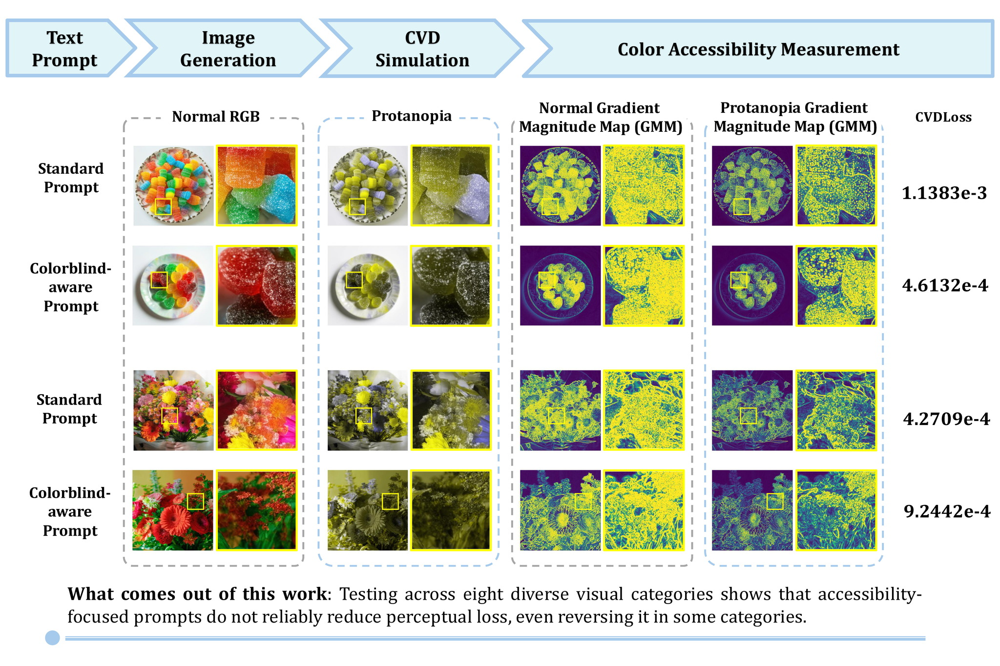

# Prompt-Driven Color Accessibility Evaluation in Diffusion-based Image Generation Models

## People
<table class=""  style="margin: 10px auto;">
  <tbody>
    <tr>
      <td>  &nbsp;&nbsp;&nbsp;&nbsp;&nbsp;&nbsp;&nbsp;</td>
      <td>  &nbsp;&nbsp;&nbsp;&nbsp;&nbsp;&nbsp;&nbsp;</td>
      <td>  &nbsp;&nbsp;&nbsp;&nbsp;&nbsp;&nbsp;&nbsp;</td>
    </tr> 
    <tr>
      <td>
<a href="https://www.linkedin.com/in/xinyao-zhuang-silvianz/">Xinyao Zhuang</a>1
</td>
      <td>
<a href="https://research.adobe.com/person/jose-echevarria/">Jose Echevarria</a>2
</td>
      <td>
<a href="https://kaanaksit.com">Kaan Akşit</a>1
</td>
    </tr>
  </tbody>
</table>

1University College London,
2Adobe Research

<b>SIGGRAPH Asia 2026 Posters</b>

## Resources 
:material-newspaper-variant: [Manuscript](https://www.kaanaksit.com/assets/pdf/ZhuangEtAl_SigAsia2026_Prompt_driven_color_accessibility_evaluation_in_diffusion_based_image_generation_models.pdf)
:material-newspaper-variant: [Supplementary](https://www.kaanaksit.com/assets/pdf/ZhuangEtAl_SigAsia2026_Supplementary_Prompt_driven_color_accessibility_evaluation_in_diffusion_based_image_generation_models.pdf)
:material-newspaper-variant: [Poster](https://www.kaanaksit.com/assets/pdf/ZhuangEtAl_SigAsia2026_Poster_Prompt_driven_color_accessibility_evaluation_in_diffusion_based_image_generation_models.pdf)
:material-file-document-outline: [arXiv](https://arxiv.org/abs/2603.09832)
??? info ":material-tag-text: Bibtex"
        @inproceedings{zhuang2026promptdriven,
          title = {Prompt-Driven Color Accessibility Evaluation in Diffusion-based Image Generation Models},
          author = {Zhuang, Xinyao and Echevarria, Jose and Ak{\c{s}}it, Kaan},
          year = {2026},
          month = dec,
          booktitle = {SIGGRAPH Asia 2026 Posters (SA Posters '26)},
          location = {Kuala Lumpur, Malaysia},
          publisher = {ACM},
          address = {New York, NY, USA},
          pages = {3},
          doi = {https://doi.org/10.1145/3829333.3847900},
          isbn = {979-8-4007-2839-6/2026/12},
        }

## Abstract
Generative models are increasingly integrated into creative workflows. While text-to-image generation excels in visual quality and diversity, color accessibility for users with Color Vision Deficiencies (CVD) remains largely unexplored. Our work systematically evaluates color accessibility in images generated by a common pretrained diffusion model, prompted to improve accessibility across diverse categories. We quantify performance using established, off-the-shelf CVD simulation methods and introduce "CVDLoss", a new metric measuring differences in image gradients indicative of structural detail. We validate CVDLoss against a commonly used daltonization method, demonstrating its sensitivity to color accessibility modifications. Applying CVDLoss to model outputs reveals that existing diffusion models struggle to reliably respond to accessibility-focused prompts. Consequently, our study establishes CVDLoss as a valuable evaluation tool for accessibility-aware image generation and post-processing, offering insights into current generative models' limitations in addressing color accessibility.

<figure markdown>
{ width="900" }
</figure>

## Overview
This study asks whether pretrained text-to-image models can produce more color accessible images through prompt design alone, without any explicit post-processing. It focuses on protanopia and deuteranopia, the most prevalent congenital color vision deficiencies.

We construct a synthetic dataset of 640 images at 1024 by 1024 pixels. It pairs two pretrained models, Stable Diffusion 3.5-large and FLUX.2 Klein 4B, with eight content categories (candy, cartoon, coral reef, flower, fruit, parrot, poster, and street view) and four prompt types of increasing specificity (standard, colorblind-aware, protanopia-aware, and deuteranopia-aware).

CVD simulation follows Machado et al. and runs at maximum severity for each image, corresponding to complete red or green blindness.

### CVDLoss
To quantify local structural accessibility, we introduce CVDLoss, a gradient-based perceptual metric. It measures the discrepancy between the gradient magnitude maps of the original image and its CVD simulation, using the perceptual 3D color gradients of Abasi et al. with the HyAB color difference computed in OKLab. Formally, the loss between an image $I$ and its CVD simulation $I_{\mathrm{CVD}}$ is

$$
\mathrm{CVDLoss}(I, I_{\mathrm{CVD}}) = \frac{\sum_{p} \left( G(I)_{p} - G(I_{\mathrm{CVD}})_{p} \right)^{2}}{N \cdot \max_{p} G(I)_{p}^{2}},
$$

where $G(\cdot)$ denotes the gradient magnitude map, $p$ indexes image pixels, and $N$ is the total number of pixels.

We validate the metric against the CVD-ViT daltonization method, which optimizes image colors for robustness under CVD simulation while preserving structural consistency with the original. The log-scale difference $\log_{10}(\mathrm{CVDLoss}_{\mathrm{recolored}}) - \log_{10}(\mathrm{CVDLoss}_{\mathrm{original}})$ is mostly negative across the eight categories, confirming that CVDLoss responds to explicit color accessibility improvements.

### Results
Applying CVDLoss to the model outputs shows that accessibility-focused prompts do not reliably reduce perceptual loss, and they even reverse it in some categories. A prompt targeted at one deficiency does not consistently improve the corresponding simulated condition. This variability appears on both Stable Diffusion 3.5-large and FLUX.2 Klein 4B, so it is not specific to a single architecture. Current text-to-image models therefore do not yet translate natural-language accessibility instructions into predictable perceptual-structural improvements.

## Relevant research works
Here are relevant research works from the laboratory:

- [They Still See Color](../documentation/optica_it_color_vision_deficiency.md)

## Outreach
We host a Slack group with more than 250 members.
This Slack group focuses on the topics of rendering, perception, displays and cameras.
The group is open to public and you can become a member by following [this link](../outreach/index.md).

## Contact Us
!!! Warning
    Please reach us through [email](mailto:kaanaksit@kaanaksit.com) to provide your feedback and comments.
